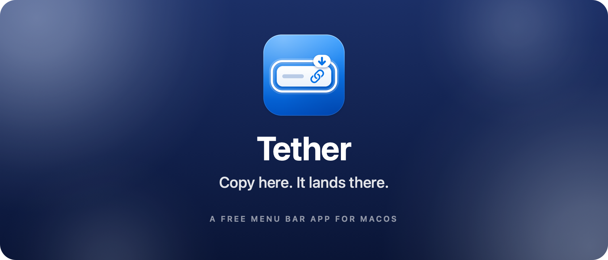
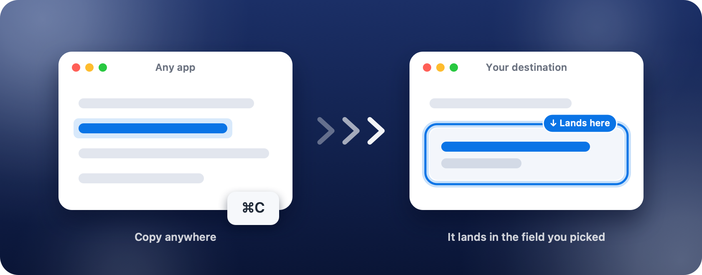

  

  <a href="https://github.com/brrrcak/Tether/releases/latest"><b>Download for Mac</b></a>

Tether is a free menu bar app for macOS. Pick a text field once, and every copy you make anywhere lands in that field. No switching windows, no pasting.

  

## Install

1. Download the latest `.dmg` from the [Releases page](https://github.com/brrrcak/Tether/releases/latest).
2. Open it and drag **Tether** onto **Applications**.
3. Open Tether from Applications. It lives in the menu bar.
4. Grant **Accessibility** access when it asks.

Needs macOS 14 or later. Runs on Apple Silicon and Intel.

**If macOS won't open it:** Tether isn't notarized by Apple yet. Open it once and click **Done**, then go to **System Settings › Privacy & Security** and click **Open Anyway**. You only do this once.

## Use

1. Click into the field you want to fill.
2. Press **⌃⌥L**. A ring marked **Lands here** appears around it.
3. Copy from anywhere with ⌘C. Each copy lands in that field.
4. Press **⌃⌥L** again to release it. **⌃⌥P** pauses.

It works in any app that accepts ⌘V, including browsers, Slack, Notes, Mail and Google Docs. Shortcuts and delivery options are in Settings.

## Privacy

Tether has no network access and collects nothing. It only reads the clipboard while a destination is live, and it skips copies that password managers mark as secret.

## Feedback

Found a bug, or an app Tether doesn't work in? [Open an issue](https://github.com/brrrcak/Tether/issues).

## License

Free to use. Copyright © 2026 Blaine Cobban. All rights reserved. See [LICENSE](LICENSE).
